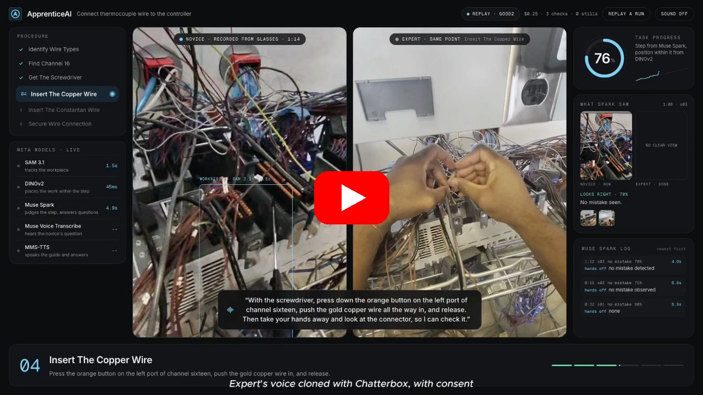
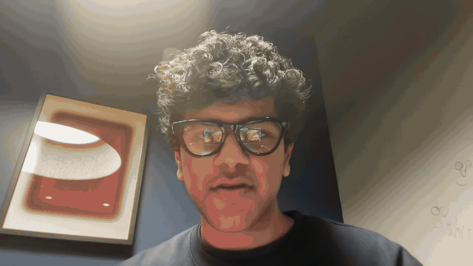
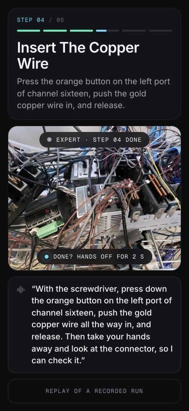
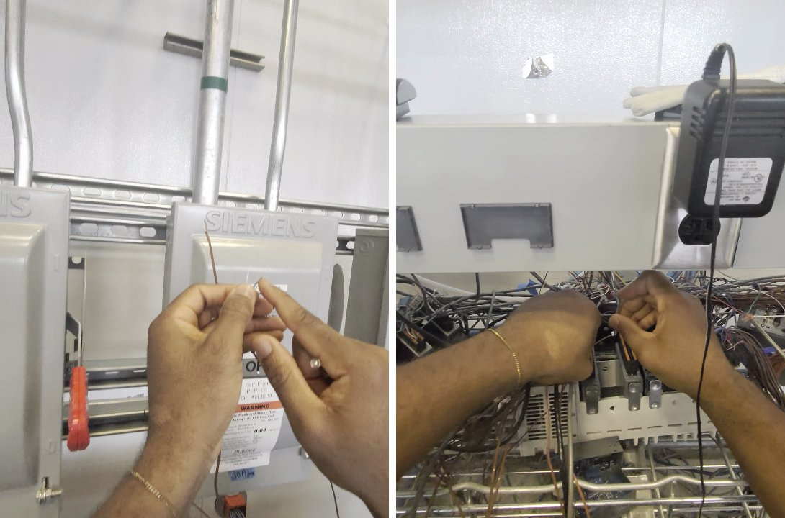
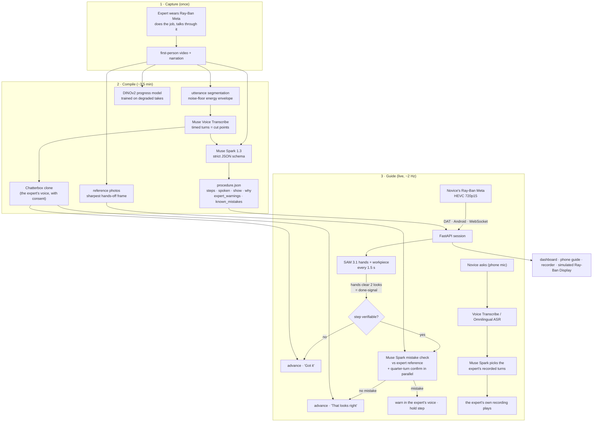
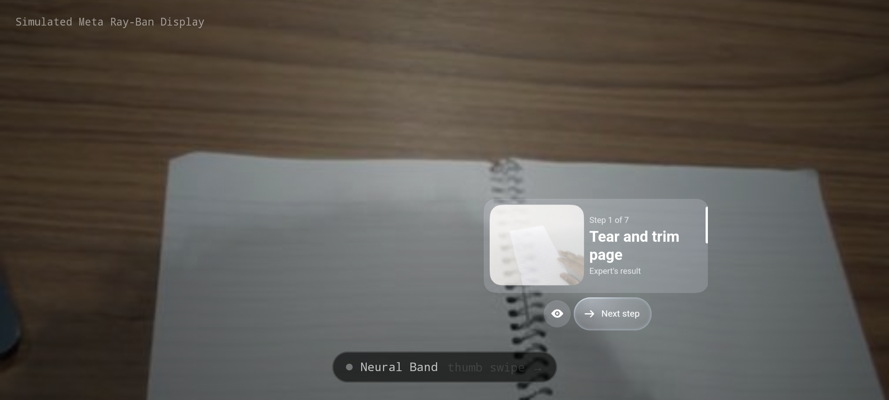
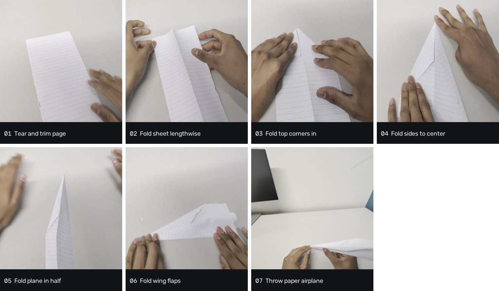

# ApprenticeAI

    

**Quick links:** [Results](#results-live-on-the-glasses-nov-4) · [How it works](#how-it-works) · [What the model decides, what stays in code](#what-the-model-decides-what-stays-in-code) · [Limits](#results-live-on-the-glasses-nov-4) · [Run it](#run-it)

[](https://youtu.be/wqdUkSTJxkM)

**An expert does a job once on Ray-Ban Meta glasses. Anyone can then do it with that expert in their ear.**

**Want early access?** [Join the waitlist](https://tally.so/r/o9D9AV)

One narrated, first-person recording is compiled by Meta's models into a step-by-step procedure: instructions in the expert's own terms, what each finished step looks like, why it matters, and the mistakes the expert warned about. A novice wearing the same glasses is then guided live, entirely in the expert's voice (cloned lines for instructions, the expert's actual recording for answers), while SAM 3.1 watches their hands and Muse Spark checks their work against the expert's.

Built for the Meta Global AI Developer Hackathon (Oct 27 to Nov 4, 2026). About 6,500 lines across a FastAPI backend, a React dashboard, and two Android apps.

<p align="center">


</p>

*Left: the dashboard during a guided run, replayed from its recording. The novice's glasses (left) beside the expert at the same point (right), the expert's line as a caption, and **What Spark saw**: the frame Muse Spark judged at the novice's hands-off signal next to the expert's photo of that step done. Right: the phone guide the wearer sees.*

## Results: live on the glasses, Nov 4

Procedure: wiring a type T thermocouple into channel 16 of a National Instruments thermocouple module, recorded by a lab expert in two takes of about three minutes each.

| Metric | Value |
|---|---|
| Recorded live runs | **18**; all **3** runs on the final six-step guide finished every step |
| Step advances since the hands-off signal | **51** across 14 runs, every one triggered by the novice's own pause, **0** manual overrides |
| Best six-step run | **2:32** |
| Signal to verdict | about 3 s (unverifiable steps), 7 to 9 s (Spark-checked steps) |
| Compile, recording to procedure | about 30 s of Muse Spark, about 3.5 min end to end |
| Cost | $0.55 to $0.61 per three-minute guided run |
| Earlier procedure (paper airplane) | 35 live advances, 0 wrong ([docs/eval.md](docs/eval.md)) |

**Measured limits, stated plainly.** From a head-mounted camera, which wire sits in which port of this connector is not visible, even in 12 MP stills with a Spark-located, upscaled crop of the connector (tested on correct and mirrored photos). So the guide never claims to verify those steps: it acknowledges them ("Got it"), plays the expert's warning at the critical step, and sends the novice to the real check, the temperature display. Automatic mistake catching is not reliable yet on either procedure.

## How it works

<p align="center"></p>

*The only input: the expert's own first-person recording on Ray-Ban Meta glasses, narrated while working (two takes, under three minutes each).*



### Compile: one recording to a procedure (`backend/apprentice/compile`)
- **Utterance segmentation** from an energy envelope relative to the room's noise floor (20th-percentile dB + 6 dB), joined across 1.2 s gaps, split at the quietest frame past 8 s; each utterance transcribed separately by **Muse Voice Transcribe** (PUSH_TO_TALK, keyword-biased), so every turn's timestamps are exact cut points for the expert's voice.
- **One Muse Spark call** over the proxy video plus the timed transcript, strict JSON schema: per step `instruction`, `spoken` (imperative, ≤22 words, never first person or "like this"), `why`, `done_check`, `expert_warnings` (only what the expert actually said) kept apart from `known_mistakes` (≤2 model-added, all `-ing` phrases so warnings stay grammatical).
- **Prompt rules learned from failures:** safety actions are always their own step; a mistake the expert demonstrates and undoes becomes a warning on the correct step, never a step (the thermocouple take first compiled "Connect Reversed Wires" as step 3).
- **Reference photos** from the sharpest hands-off frame per step, re-pickable (`tools/repick_ref.py`).
- **Voice:** every line rendered in the expert's cloned voice (Chatterbox Turbo, 30 s denoised reference from the expert's own narration, with written consent); unchanged lines are reused by text match on re-render.

### Guide: when to look, what to say (`backend/apprentice/guide`)
- **Signal mode** (`advance_on: signal`): a head-worn camera never holds still, so frame differencing is useless. SAM 3.1 looks for hands every 1.5 s; two clear looks with no hand touching the workpiece box is the novice saying "done". With no workpiece box in view, no hand in frame is the signal.
- **Signals are ignored** during a step's first 6 s and while any voice line is still playing (hold = running total of queued line lengths), and re-arm after 8 s of continued stillness.
- **Per-step policy from `procedure.json`:** `verifiable: false` steps advance on the signal alone with a neutral acknowledgement (no Spark call, about 3 s); others get a Spark mistake check against the expert's reference, with a quarter-turned confirmation run in parallel so a false alarm costs one call's latency, not two. `tip` plays the expert's check-before-you-commit on a step's first pause. `show` tells the novice how to present the finished step.
- **`expert_voice_only`:** step lines, warnings, acknowledgements, intro and closing are all the expert's cloned voice; anything without a clone is shown as text, never spoken in another voice.
- **Ask the expert:** Spark is given the expert's numbered transcript turns and the live frame, returns `{clip_from, clip_to, answer}` under a strict schema, prefers the shortest clean passage (no slips or asides), capped at about 12 s of speech; the answer audio is the expert's own recording, the written answer goes to the screens. Questions nothing covers play the expert's cloned "I didn't cover that when I recorded this".
- **Presence:** rotating phrasings (no line twice in a row), reminders only after 20 s of real silence and never within 6 s of a hand on the work.
- **Tracker** (`state.py`): one-step-at-a-time advances, stale answers dropped, pending advances survive one contradicting answer, warnings need two positive checks outside signal mode.

### Perception (`backend/apprentice/progress`, `models`)
- **SAM 3.1** over the Meta Model API with text and box prompts; box-prompt following between ticks with plausibility gates (IoU and scale).
- **DINOv2** embeddings of workpiece crops, trained per procedure on the expert takes after degrading them to match the glasses' stream; fused into a monotonic, step-anchored gauge.
- **Target tracking** (`track_target`, off by default): Spark finds a target SAM cannot name, SAM follows it by box prompt, Spark re-finds every 15 s and drops tracks it cannot see. Built and measured; not enabled because on the rack it held the connector in about 10% of ticks.

### Resilience
- **Muse Spark Open on Baseten** takes over any Spark call on transport errors, 5xx or 429 (reasoning tokens need about 8,000 max tokens and a 30 s timeout).
- **Omnilingual ASR CTC 300M** runs locally in its own process (fairseq2 pins torch 2.8 and NumPy 1), first for non-English questions and as the fallback for Voice Transcribe.
- **Spend cap** (`SPEND_CAP_USD`, default 40), per-call timeouts so a slow SAM call never stalls the tick, every session recorded (`out/sessions/<time>_<run>`: HEVC stream, ticks, stills, asks) and replayable.

### Surfaces
- **Dashboard** (`web/app`, React + Tailwind + Framer Motion, prebuilt in `web/build`): the novice's view beside the expert at the same point, the spoken caption, the step list, the gauge, the Muse Spark log, and **What Spark saw**: at each signal, the novice's frame beside the expert's done photo with the verdict.
- **Phone guide** (`/guide`) and the **Android app** (`android/app`, Kotlin + Compose, DAT 1.0.1): streams the glasses, plays the voice queue, hold-to-ask on the phone mic (the glasses' mic ends the camera stream).
- **Simulated Meta Ray-Ban Display** (`android/lens`): the guide drawn by Meta's own Display renderer via MockDeviceKit, composited over the live view with a screen blend (a waveguide only adds light), Neural Band swipes and pinches through `InputSource.NEURAL_BAND`. See [docs/lens.md](docs/lens.md).

## What the model decides, what stays in code

| Decided by Muse Spark | Fixed in code |
|---|---|
| The steps, their wording, done-checks and warnings (at compile time, schema-bound) | Whether a step can be verified at all (`verifiable`), and that unverifiable steps are never called right |
| Whether the novice's frame shows a mistake against the expert's photo | When to look: the hands-off signal (SAM 3.1), holds while speech plays, the 6 s minimum, re-arm timing |
| Which of the expert's recorded turns answers a question | Advancing one step at a time, dropping stale answers, the confirmation of every warning |
| Where an unnamed target is in a frame (`track_target`) | That every spoken line is the expert's voice or shown as text (`expert_voice_only`) |

The model never moves the guide on its own: a step advances only on the novice's own signal, and a warning only holds the step.

<p align="center"></p>

*Simulated Meta Ray-Ban Display (`android/lens`): the step and the expert's photo drawn by Meta's own Display renderer (MockDeviceKit), screen-blended over the live view, driven by Neural Band swipes and pinches.*

## Earlier procedure: a paper airplane

<p align="center"></p>

*The first procedure, compiled from one narrated recording the same way: seven steps, from tearing the page to throwing the plane. Run `catch5` completed all seven steps live, throw included (the plane leaving the view ends the run), and the guide made 35 live step advances across runs with none early and none skipped ([docs/eval.md](docs/eval.md)). It ships as the no-key replay below.*

## Models

| Model | Where | Job |
|---|---|---|
| Ray-Ban Meta + Wearables Device Access Toolkit | glasses, Android | camera stream, stills, speakers |
| Muse Spark 1.3 | Meta Model API | compile, live checks, answer selection, translation, target finding |
| SAM 3.1 | Meta Model API | hands-off signal, workpiece and target tracking |
| Muse Voice Transcribe | Meta Model API | expert narration turns, novice questions |
| Omnilingual ASR (CTC 300M) | local, open weights | non-English questions, fallback |
| MMS-TTS | local, open weights | other-language guides (Spanish thermocouple, Hindi paper airplane) |
| DINOv2 | local, open weights | progress gauge, expert mirror |
| Muse Spark Open | Baseten | automatic fallback for every Spark call (Meta's open model on Baseten, only when `BASETEN_API_KEY` is set) |

## Run it

No glasses, no key, replays a recorded live run:

```bash
cd backend && uv sync
PYTHONPATH=. .venv/bin/uvicorn apprentice.server:app --port 8000
```

<http://localhost:8000/?demo=1> for the dashboard (replays the bundled paper airplane run `catch5`; the thermocouple runs in the video are not bundled), <http://localhost:8000/build?procedure=thermocouple> for what the expert's one recording became (the take, the timed words, the six steps, the cloned voice; Spanish toggle), <http://localhost:8000/guide> at phone size for the wearer's screen. Tests: `cd backend && uv run pytest -q`.

Live: `META_API_KEY` in `.env`, the glasses in Developer Mode, the app from `android/` on a phone over USB (`adb reverse tcp:8000 tcp:8000`). A new procedure from an expert's recording (needs ffmpeg, adb, and [Chatterbox](https://github.com/resemble-ai/chatterbox) in `~/.venvs/clone` for the voice clone; Chatterbox is the only non-Meta model, it is TTS and runs offline at compile time):

```bash
KEYWORDS="thermocouple,copper,constantan" WORKPIECE="wires" tools/new_procedure.sh thermocouple take1.mp4 take2.mp4 voice_sample.wav
```

## More
[docs/eval.md](docs/eval.md) every live run, misses included · [docs/rubric-map.md](docs/rubric-map.md) judging criteria to evidence · [docs/lens.md](docs/lens.md) Display mode · [docs/video.md](docs/video.md) the video, shot by shot, against the code · [BUILT_DURING_HACKATHON.md](BUILT_DURING_HACKATHON.md) provenance
