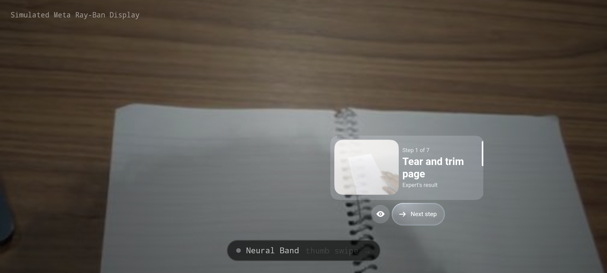

# Display mode (simulated Meta Ray-Ban Display)

`android/lens` is a second app, Apprentice Lens, that shows the guide the way a Meta Ray-Ban
Display wearer would see it: the step and the expert's photo in the right-eye display, with
**Check me** and **Next step** driven by Neural Band gestures. No phone in the hands.

We don't have Display glasses, so it runs on Meta's MockDeviceKit (`GlassesModel.META_RAYBAN_DISPLAY`):

- The lens content goes through the real Display API (`DeviceSession.addDisplay`, `Display.sendContent`)
  and is drawn by Meta's own renderer (`MockDisplayKit.createPreviewView`). The same code targets
  real Display glasses once `MockDeviceKit` is dropped.
- The world behind the display is the live Ray-Ban Meta camera from the server's `/ws/guide`.
  The display is composited with a screen blend, because a waveguide only adds light, so black is
  see-through. A light tint stands in for the Display's transition lenses.
- Neural Band: a swipe anywhere is a thumb swipe (moves focus between the buttons), a tap is a
  pinch (presses the focused button), and a long press is back. Gestures are sent as
  `InputSource.NEURAL_BAND` through `MockInputKit`. The mock does not move display focus from
  input, so the app keeps focus and re-renders with the renderer's focus (`ActionRole.PRIMARY`).
- Check me posts `/api/check`, and Next step posts `/api/goto`, the same endpoints the phone guide uses.
  Warnings, check verdicts and the expert's recorded answer appear as a line above the step.

The camera app (`android/app`) is unchanged and still drives the real glasses.



## Run it on the laptop (for screen capture)

```bash
cd android && ./gradlew :lens:assembleDebug
$ANDROID_HOME/emulator/emulator -avd lens -no-audio &     # created with avdmanager, 2400x1080
adb -s emulator-5554 install -r lens/build/outputs/apk/debug/lens-debug.apk
adb -s emulator-5554 reverse tcp:8000 tcp:8000
adb -s emulator-5554 shell am start -n ai.apprentice.lens/.LensActivity
```

Start a live session from the Pixel as usual, or replay one with `curl -X POST "localhost:8000/api/demo?session=catch5"`.
In the emulator window, drag to swipe and click to pinch.
